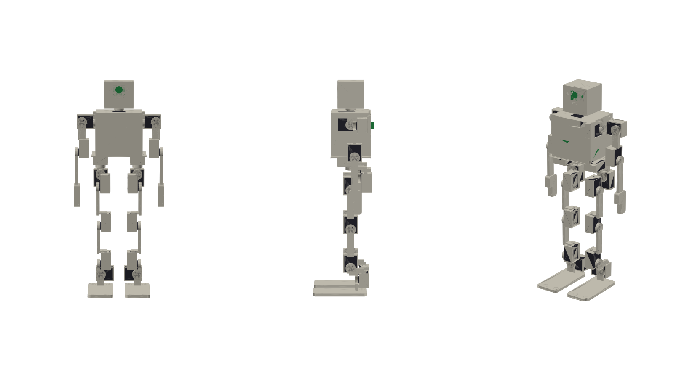
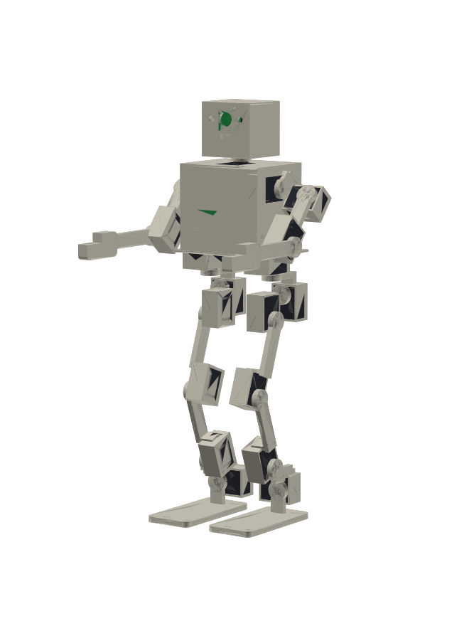

# bot — a 20-DOF, 60 cm, sub-$2000 humanoid you can build

A complete, parametric design: CAD (CadQuery → STEP/STL/GLB), bill of materials, wiring, firmware, physics simulation and build docs for a ~2.5 kg, 595 mm tall biped with arms and a pan/tilt head.



| | |
|---|---|
| Height / mass | 595 mm / 2.5 kg (model; see [analysis](docs/ANALYSIS.md)) |
| DOF | 20: 2 × 6 leg, 2 × 3 arm, 2 neck (yaw+pitch) |
| Actuators | 8 × Feetech STS3250 (4.9 N·m) + 12 × STS3215 (2.9 N·m), serial bus, 12-bit magnetic encoders |
| Brain | Raspberry Pi 5 + BNO085 IMU + 8 foot force sensors + USB camera |
| Power | 3S LiPo 3000 mAh, ~40 min walking (estimate), 20 A fuse, hard kill switch |
| Structure | 27 FDM parts, 559 g of PETG-CF/PETG/TPU, every part fits a 220 mm bed |
| **BOM** | **$1,943** incl. spare servo, shipping/tax allowance and reserves ([BOM](bom/BOM.md)) — $57 under budget |
| Verified in software | no CAD clashes in 11 joint-sweeps + 8 combined poses, torque margins, stands and walks in MuJoCo |

**Interactive 3D viewer** (poses + joint sliders): `python3 -m http.server` in the repo root, open `http://localhost:8000/docs/viewer/`.
Simulation clip: [`out/walk_sim.gif`](out/walk_sim.gif).

## Read this first — what is and is not verified

This repository was produced without physical access to the parts. Everything below the line is checked by code (`make test`, 16 tests); everything above it is **not** and you must check it on your bench before printing in bulk.

| Status | Item |
|---|---|
| ⚠ verify | **Servo envelope & interface** (`cad/params.py: SERVOS`, `HORN_*`, `FLANGE_*`, mount-hole pattern). Taken from public datasheets (45.2 × 24.7 × 35 mm; shaft offset, horn spline/bolt circle and mounting holes are placeholders). Print one cradle + one flange first (`out/stl_print/pelvis.stl` has two cradles), measure, edit `params.py`, `make all`. |
| ⚠ verify | STS3250 mass (75 g) and stall current (3.5 A) are assumed; prices are Oct-2026 retail estimates with a drift reserve. |
| ⚠ verify | Walking: quasi-static gait with tilt feedback works in simulation (ideal servos, no backlash/latency). Expect to tune gains on hardware — **tether it for the first steps**. |
| ✔ checked | Joint ranges are collision-free (CAD sweep), static torque ≤ 65 % of stall at every joint, printed bars < 12 MPa at servo *stall*, BOM total ≤ $2000, servo counts BOM = CAD, firmware packets, mirror-symmetry of L/R angle conventions. |
| ✘ not done | FEA, thermal test of servos under sustained crouch (hip-roll/knee run ~1.0× rated torque while single-leg standing), vision/AI software beyond camera capture. |

## Quick start

```bash
make setup           # venv + CadQuery, MuJoCo, ...
make all             # CAD -> model.json -> joint config, URDF, analysis, BOM, STEP/STL/GLB, renders, tests
make sim             # MuJoCo: stand in crouch + walk 8 steps
python firmware/cli.py --dry-run walk      # control stack against a fake servo bus
```

## Repo map

| Path | What |
|---|---|
| `cad/params.py` | **the** dimensions: servo envelopes, link lengths, foot, clearance |
| `cad/skeleton.py` | joint table (position, axis, servo, limits, bar routing) — edit here to change the robot |
| `cad/{kin,parts,robot}.py` | generic link builder, custom parts (pelvis, torso, head, foot, hand), assembly + FK |
| `cad/sweep.py`, `pairtest.py`, `clash.py` | collision-free joint ranges and combined-pose checks |
| `out/` | generated: `robot.step`, `robot.glb`, `stl_print/*.stl`, `step/*.step`, `model.json`, reports |
| `analysis/` | torque envelope, printed-link stress, power/runtime |
| `sim/` | URDF generator + MuJoCo stand/walk tests |
| `firmware/` | Feetech driver, joint config, leg IK, gait, tilt stabiliser, sensors, `cli.py` |
| `bom/` | `bom.csv` (source), `BOM.md` (generated) |
| `docs/` | [DESIGN](docs/DESIGN.md) · [BUILD_GUIDE](docs/BUILD_GUIDE.md) · [WIRING](docs/WIRING.md) · [BRINGUP](docs/BRINGUP.md) · [SAFETY](docs/SAFETY.md) · [PRINT_GUIDE](docs/PRINT_GUIDE.md) · [ASSEMBLY_TABLE](docs/ASSEMBLY_TABLE.md) · [HARNESS](docs/HARNESS.md) · [ANALYSIS](docs/ANALYSIS.md) |


